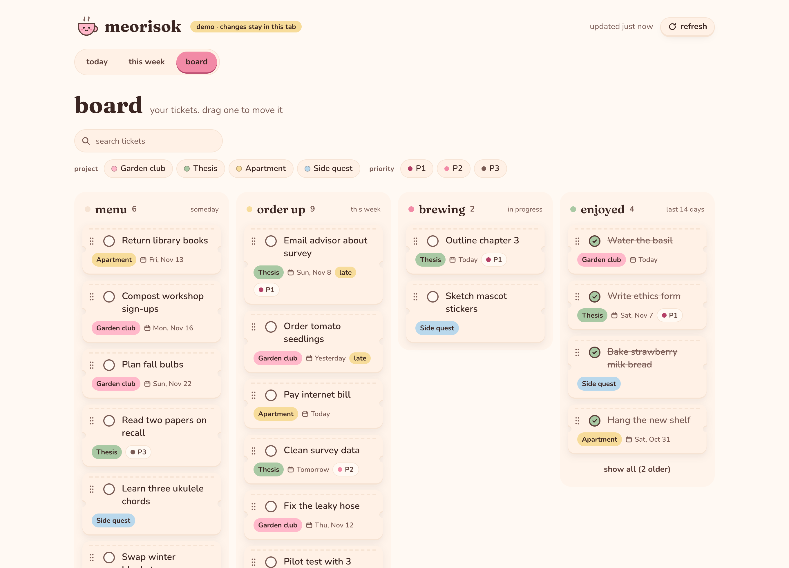
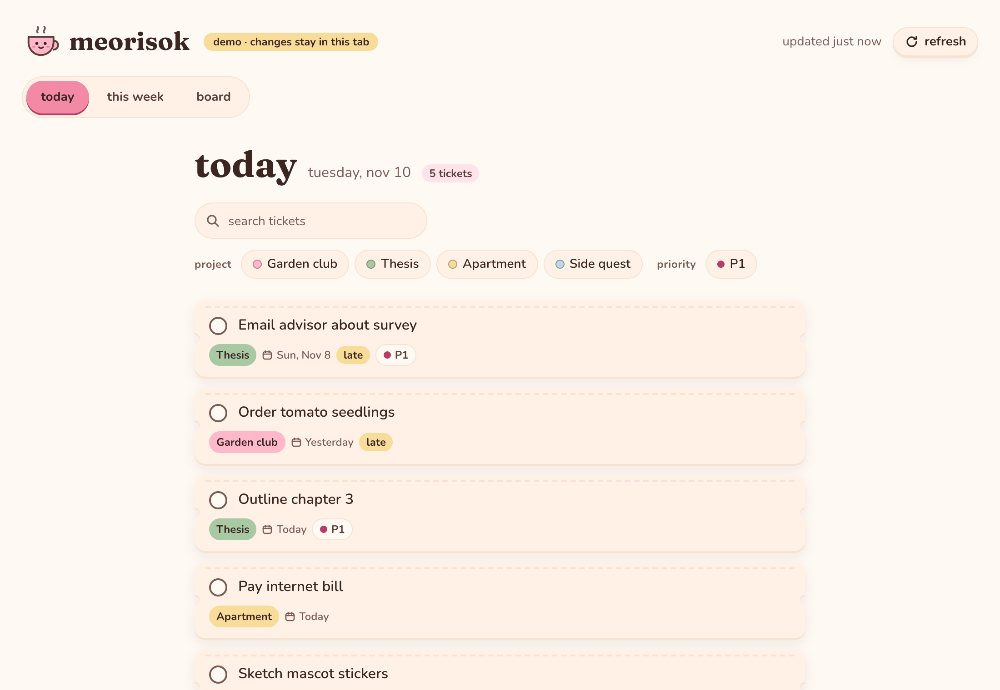
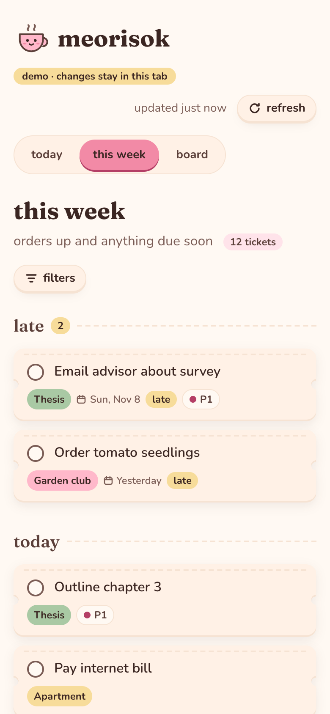
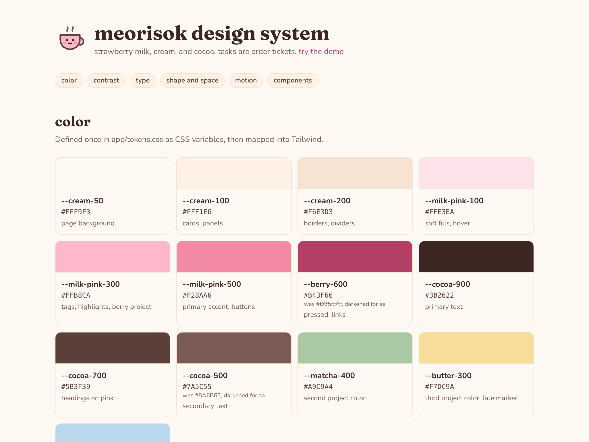

# meorisok

A tiny cafe for my Notion tasks. It pulls tasks from my Notion Kanban databases into one place, shows them as order tickets, and lets me move them along without opening Notion.

**[Try the demo](https://meorisok.vercel.app/demo)** · **[Design system](https://meorisok.vercel.app/design)**



The real app is password-protected and only for me. The demo runs the same UI on made-up tasks, and nothing you do there leaves your browser.

## What it does

- **today**: anything due today or overdue, plus tickets I'm working on that have no date. Late ones get a small "late" marker.
- **this week**: tickets in Order Up plus anything due in the next 7 days, grouped by day.
- **board**: four columns across every project. Drag a ticket to change its status. The change is written back to Notion.
- **Filters** by project, priority, and title search. They live in the URL, so a filtered view can be bookmarked. On phones they fold behind a "filters" button.
- **Check a ticket off** anywhere to move it to Enjoyed. The mascot does a little bounce.
- **Only my tickets.** Tasks assigned to other people in a shared database are filtered out on the server.

| today | this week (phone) | design system |
|---|---|---|
|  |  |  |

## The cafe metaphor

Statuses get cafe names in the UI. Notion keeps its own labels, so nothing changes on the Notion side.

| Notion status | In meorisok | Meaning |
|---|---|---|
| Backlog | menu | someday |
| This Week | order up | committed for this week |
| Doing | brewing | in progress |
| Done | enjoyed | finished |

Matching is case-insensitive, so `This Week` and `this week` both work. An unknown label shows up in Menu and logs a warning instead of breaking the page.

## Setup

You need Node 20+ and a Notion workspace.

1. **Clone and install**
   ```sh
   git clone https://github.com/stephalee11/meorisok.git
   cd meorisok
   npm install
   cp .env.example .env.local
   ```
2. **Make a Notion integration** at [notion.so/profile/integrations](https://www.notion.so/profile/integrations). Give it "Read content" and "Update content". It doesn't need user info. Copy the secret into `NOTION_TOKEN` in `.env.local`.
3. **Connect it to each database.** Open the database in Notion, then "..." → Connections → add your integration. Without this, Notion answers 404.
4. **Fill in the rest of `.env.local`**
   ```sh
   MEORISOK_PASSWORD=pick-a-password
   SESSION_SECRET=$(openssl rand -base64 32)   # paste the output, 32+ characters
   ```
5. **Point the config at your databases and at you** in `meorisok.config.ts` (see below).
6. **Run it**
   ```sh
   npm run dev
   ```
   Open http://localhost:3000. `/demo` and `/design` work without logging in.

### Deploying

Import the repo into Vercel and add the same three environment variables (`NOTION_TOKEN`, `MEORISOK_PASSWORD`, `SESSION_SECRET`). Use a fresh `SESSION_SECRET` for production. Vercel only applies changed variables to new deployments, so redeploy after editing them.

## Adding a source

Everything about a source lives in `meorisok.config.ts`. To add a database, add an entry:

```ts
{
  id: "garden",                    // short, unique, used in URLs
  label: "Garden club",            // shown on the project chip
  dataSourceId: "…",               // the Notion data source id
  color: "butter",                 // berry | matcha | butter | sky
  props: {
    title: "Name",                 // your Notion property names
    status: "Status",
    due: "Due Date",
    assignee: "Owner",             // optional: people column, for "only my tickets"
    priority: "Priority",          // optional: select with P1 / P2 / P3
  },
},
```

Then share the database with your integration (setup step 3). Optional properties can be left out and the UI just won't show them.

`me.notionUserId` at the top of the same file is your Notion user id. Tickets are kept if you're one of the assignees, or if the source has no `assignee` column.

## How it works

```
browser ──► proxy.ts (session check) ──► (app)/layout.tsx ──► lib/notion.ts ──► Notion API
                                              │                    │
                                              │      "use cache", 60s, tag "tasks"
                                              ▼
                                         LiveApp (client): views, drag and drop,
                                         optimistic updates ──► PATCH /api/tasks/[id]/status
```

- **Reading.** `lib/notion.ts` queries each data source with the `2025-09-03` Notion API (pinned on purpose), follows pagination past 100 rows, and turns pages into a small `Task` shape in `lib/normalize.ts`. Sources load in parallel, and one failing doesn't take down the other. You get a "Wander didn't load" banner instead.
- **Caching.** Results are cached for 60 seconds with Next's `"use cache"`. Refresh throws the cache away and refetches.
- **Writing.** Moving a ticket updates the UI right away, then `PATCH`es the server. The server looks up the exact status label that database uses (`This Week` vs `this week`) from its own schema, refuses pages that aren't in that database, and updates Notion. If that fails, the ticket slides back and a toast says so.
- **Dates.** "Today" comes from your browser's clock, not the server's (Vercel runs in UTC). The app shell renders in the browser for that reason.
- **Access.** One password, checked with a constant-time compare, then a signed, httpOnly, 30-day cookie (`jose`). `proxy.ts` guards everything except `/login`, `/demo`, and `/design`, and the API routes and app layout check the session again themselves. Login is limited to 5 tries per 10 minutes per IP (in memory). The Notion token is only read in server code, and raw Notion errors never reach the browser.

## Design decisions

- **Tickets, not cards.** Each task is a little receipt: cream paper, a dashed tear line on top, notches on the sides (a CSS mask), and a flat sticker shadow that follows the notched shape.
- **Strawberry milk palette, checked for contrast.** Every text and background pair is listed on `/design` with its ratio. Two colors from the original palette failed WCAG AA and were darkened: secondary text `#8A6B63` → `#7A5C55`, and the link pink `#D2587E` → `#B43F66`. White text fails on every pink, so buttons use cocoa text.
- **All lowercase.** Headings, tabs, buttons, and messages are lowercase to keep the tone soft. Ticket content keeps whatever casing it has in Notion.
- **Fewer controls.** There's no status menu on tickets. You drag on the board, and a checkbox handles "done" everywhere else. Phase is read from Notion but not shown or filtered. Fewer things on each ticket made the lists easier to scan.
- **Motion that means something.** Tickets slide onto the pass when they land in a column, and the mascot bounces when something's enjoyed. Everything is 150-200ms ease-out and switches off with `prefers-reduced-motion`.
- **Keyboard first-class.** Each board ticket has a grip you can pick up with Space and move between columns with the arrow keys. Screen readers hear "Moved Outline chapter 3 to brewing." When a ticket leaves the list, focus goes to its neighbor instead of jumping back to the top of the page.
- **Type.** Fraunces for headings, Nunito for everything else.

## Notes from building it

- **The Notion API changed shape.** Since `2025-09-03`, databases hold one or more *data sources*, and you query the data source, not the database. The version is pinned so an SDK upgrade can't quietly change behavior.
- **Status labels differ between databases.** One uses `This Week` and the other `this week`. Hardcoding either would break the other, so writes read the label from that database's schema (cached for an hour, re-read once if a label is missing).
- **"Due today" is a timezone question.** On a server in UTC, "today" would flip in the middle of my afternoon. Rendering the date logic in the browser fixed that without storing a timezone anywhere.
- **Next 16 renamed `middleware` to `proxy`.** The behavior is the same. I still check the session in the routes themselves, close to the data, so security doesn't hang on one file.
- **Links were stealing drags.** Real tickets link back to Notion, and my "don't start a drag from interactive things" rule made them impossible to grab by the title. Now links take part in drags, and a click without movement still opens Notion.

## Ideas for later

Jira as a second source type, a "what should I do now" nudge from due date and priority, dark mode, a weekly recap card, and an installable PWA.

## Scripts

```sh
npm run dev     # local dev server
npm run build   # production build
npm run lint    # eslint
```

Built with Next.js 16 (App Router, Cache Components), TypeScript, Tailwind CSS 4, `@notionhq/client`, `@dnd-kit/core`, and `jose`.
